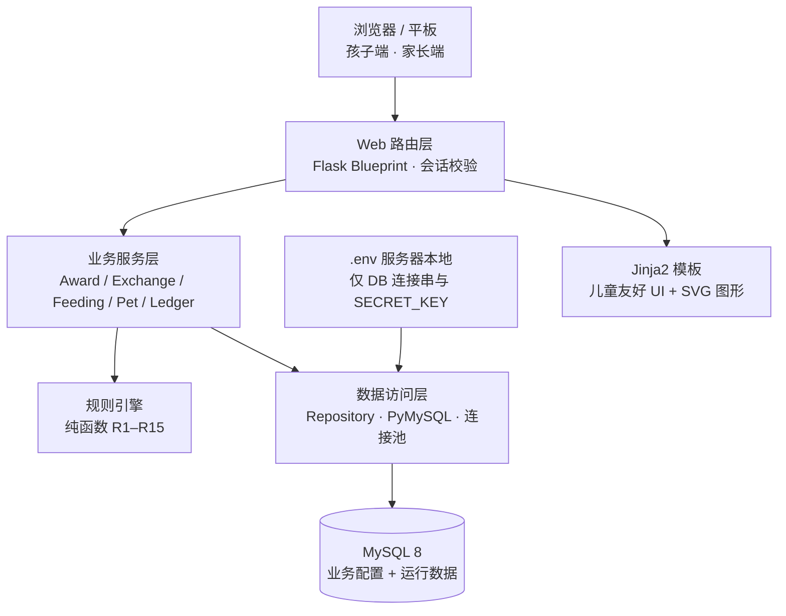
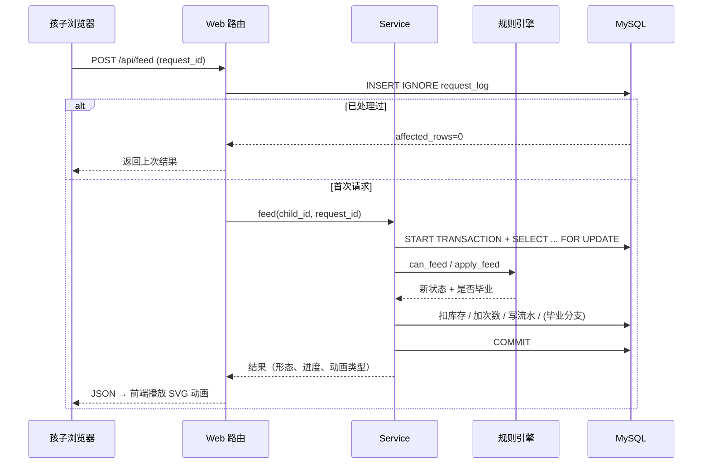

# 孩子宠物养成系统 · 架构与实现方案 v2.1

> **配套阅读**：`宠物养成系统设计.md`（规则、数值、状态、页面）。本文回答「怎么实现、需要什么架构」。
> **本版变化**：改用 **MySQL**（部署在有轻量云服务器上）、**配置尽量入库**（只有数据库连接信息留在文件）、**儿童友好前端规范**、**动物图形生成方案**。
> **目标环境**：轻量云服务器（Linux + Python 3.9+ + MySQL 8）+ 孩子平板/手机/电脑浏览器，HTTPS 访问。
> **本文范围**：技术选型、分层、目录、表与索引、事务、规则引擎、核心流程、鉴权、儿童 UI、图形方案、部署、测试、实施路线。不含完整实现代码，给到可直接施工的接口签名与 SQL 要点。

---

## 0. 架构结论（先看这个）

> **一句话**：Flask + MySQL 跑在云服务器上，浏览器（含平板/手机）访问；**只有数据库连接串和密钥放在服务器本地 `.env`，其余配置全部存入 MySQL**；前端用 Jinja2 + 原生 JS，宠物图形用参数化 SVG（可动画、风格统一）。

| 维度 | 选择 | 理由 |
|---|---|---|
| 形态 | 云服务器 Web 应用 | 你有轻量服务器；多设备随时访问，数据集中不丢 |
| 后端 | Flask（gunicorn 托管） | 你已有 Flask 经验；路由/模板/静态一站式 |
| 数据库 | **MySQL 8**（InnoDB / utf8mb4） | 云服务器常备；事务、行锁、生成列约束都够用 |
| 连接配置 | **服务器本地 `.env`**（不进代码库、不入库） | 主机/端口/库名/账号/密码/SECRET_KEY 是唯一留在文件里的东西 |
| 业务配置 | **全部入 MySQL** | 奖项库、宠物链、汇率、阈值、假期模式、账号、PIN hash 都在表里；家长端界面直接改 |
| 宠物目录 | **`config/pets.json` → `pet_species`** | 物种数量和档案可扩展；`init_db()` 自动同步，旧数据不覆盖 |
| 前端 | Jinja2 首屏 + 原生 JS `fetch`，**儿童友好大图形界面** | 无 npm、无构建；全屏无滚动、大按钮、大图形、少文字 |
| 宠物图形 | **参数化 SVG 矢量**（非 AI 位图） | 10 种风格统一、放大不糊、可用 CSS 驱动待机/打招呼/说话动画、体积极小 |
| 鉴权 | 家长账号密码 + 孩子端 4 位 PIN | 公网访问必须有真账号体系；孩子端 PIN 防外人乱点 |
| 部署 | Nginx 反向代理 + HTTPS + 定时 `mysqldump` | 标准轻量云配置，成本可控 |

**为什么图形不用 AI 生成位图**：30 张图（10 种 × 3 形态）用 AI 逐张生成，风格一致性差、体积大、无法做 CSS 动画；SVG 是参数化画出来的，改一个颜色就能批量重生成，且能直接驱动待机、打招呼和说话动画。详见第 11 节。

---

## 1. 技术选型对比（被否决的方案）

| 方案 | 否决原因 | 本方案做法 |
|---|---|---|
| SQLite 单机 | 已有云服务器，不用白不用；多设备访问需要集中数据 | MySQL on 云服务器 |
| 配置文件放业务配置 | 家长改配置要登录服务器改文件，且无审计、易改错 | 配置全部入库，家长端表单改 |
| AI 生成宠物位图 | 风格不一致、体积大、无法做动画 | 参数化 SVG 批量生成 |
| 前端框架 + 构建 | 引入 Node 工具链，增加部署复杂度 | Jinja2 + 原生 JS |
| 纯 PIN 无账号 | 公网暴露，PIN 无法做权限分级与找回 | 家长账号密码 + 孩子 PIN 双体系 |
| 微服务 / 容器编排 | 过度工程 | 单 Flask 进程 + gunicorn |

---

## 2. 分层架构



| 层 | 职责 | **明确不允许** |
|---|---|---|
| Web 路由层 | 解析参数、校验会话、调用 Service、选模板 | 不写业务判断、不直接碰 SQL |
| 业务服务层 | 编排一次完整动作，开启/提交事务，协调多个 Repository | 不做页面渲染、不读 HTTP 请求对象 |
| **规则引擎** | 纯函数：`(当前状态, 动作) → (新状态 \| 错误码)` | **不 import Flask、不碰 DB、不读时间**（时间由参数传入） |
| 数据访问层 | 参数化 SQL、事务内读写、读配置、映射领域对象 | 不含业务规则 |
| `.env` | **只放数据库连接信息与应用密钥** | 不放任何业务配置、不进版本库 |

> **规则引擎为什么必须是纯函数**：R1–R15 是这套系统的价值核心。隔离成无副作用函数后，每条规则都能单测、能脱离 Web 和数据库验证；换前端或换数据库都不用改规则。

---

## 3. 目录结构

```
pets/
├── app.py                       # 入口：create_app()、注册蓝图、gunicorn 加载
├── .env                         # 【唯一本地配置】DB 连接串、SECRET_KEY（.gitignore 排除）
├── requirements.txt             # Flask / PyMySQL / gunicorn / python-dotenv
├── config/
│   ├── seed.sql                 # 首次建库种子：默认奖项、初始 5 阶宠物、app_config 初值
│   └── pets.json                # ★ 可扩展宠物目录：10 种怪兽 + 档案 + 图形参数
├── schema.sql                   # DDL：全部表 + 索引 + 生成列约束
├── pet_system/
│   ├── config.py                # 读 .env；运行时业务配置从 MySQL 的 app_config 读
│   ├── db.py                    # 连接、transaction() 上下文、init_db()（顺带同步目录）
│   ├── catalog.py               # ★ 读取/校验 config/pets.json，补列并同步 pet_species
│   ├── domain/
│   │   ├── state.py             # 状态枚举、Formula、GameState 数据结构
│   │   └── rules.py             # R1–R15 纯函数（核心资产）
│   ├── services/
│   │   ├── award.py             # 申请/确认/驳回/撤回
│   │   ├── exchange.py          # 兑换 + 库存
│   │   ├── feeding.py           # 宠物视图、喂食、形态/毕业、图鉴、随机说话
│   │   ├── ledger.py            # 账本查询 + 一致性重算
│   │   └── settings.py          # 配置读写（家长端改配置走这里，带审计）
│   ├── repo/
│   │   └── store.py             # 所有 SQL 集中在这里
│   └── web/
│       ├── child.py             # /child 孩子端
│       ├── parent.py            # /parent 家长端（账号登录）
│       ├── api.py               # /api JSON 接口
│       ├── templates/           # child_*.html / parent_*.html
│       └── static/
│           ├── css/             # 儿童友好样式（大按钮、无滚动）
│           ├── js/              # 原生 fetch、动画触发
│           ├── audio/           # 破壳/长大/毕业短音效
│           └── pets/            # ★ SVG 宠物图形（10 种 × 3 形态）
├── tests/
│   ├── test_rules.py            # R1–R15 逐条单测（不连 DB）
│   ├── test_catalog.py          # 目录链完整、档案齐全、图形特征合法
│   ├── test_transactions.py     # 三大事务 + 并发防重（连测试库）
│   └── test_ledger.py           # 账实一致性
├── tools/
│   ├── verify_ledger.py         # 账本校验/修复
│   ├── gen_pets_svg.py          # ★ 参数化批量生成 30 个 SVG
│   ├── selftest.py              # 端到端自测（有真实数据默认拒绝清空）
│   └── selftest_fullchain.py    # 全链路自测（同样有清空保护 + 备份）
├── deploy/
│   ├── nginx.conf               # 反向代理 + HTTPS
│   ├── pets.service             # systemd 托管 gunicorn
│   └── backup.sh                # 每日 mysqldump + 异地拷贝
└── README.md                    # 部署与运维说明
```

**约束**：`services/` 之间不互相 import；`repo/store.py` 是唯一允许出现 SQL 的地方；业务配置只能经 `settings.py` 修改并写审计日志。

---

## 4. MySQL 数据库落地

### 4.1 完整表清单

| 表 | 关键字段 | 用途 |
|---|---|---|
| `app_config` | `config_key PK, value_json JSON, updated_by, updated_at` | **业务配置**（汇率、库存上限、阈值、假期模式、图形版本） |
| `admin_user` | `id, username, password_hash, salt, created_at` | 家长账号 |
| `child` | `id, name, avatar, pin_hash, salt, points_balance, current_pet_id` | 孩子档案 + 家长 PIN |
| `award` | `id, name, icon, points, daily_cap, need_approval, category, exclusive_group, enabled, source_type, effective_from/to, sort_order` | **奖项库配置** |
| `award_claim` | `id, child_id, award_id, claim_date, status, approver_id, note, created_at` + 生成列 | 申请与审核流水 |
| `point_ledger` | `id, child_id, type, delta, balance_after, ref_type, ref_id, operator, note, created_at` | 只追加账本 |
| `exchange_order` | `id, child_id, points_spent, milk_qty, cookie_qty, request_id, created_at` | 兑换单 |
| `food_stock` | `child_id PK, milk, cookie, updated_at` | 冗余库存 |
| `pet_species` | `id, tier, name, egg_name, formula_milk, formula_cookie, feed_times, next_species_id, svg_key, profile_json` | **宠物链配置**；`profile_json` 存爱好/习性/叫声/台词/动画 |
| `pet_instance` | `id, child_id, species_id, status, feed_count, started_at, graduated_at` + 生成列 | 一只宠物的生命周期 |
| `feeding_record` | `id, pet_id, milk_used, cookie_used, feed_count_after, request_id, created_at` | 喂食流水 |
| `codex` | `child_id, species_id, first_graduated_at, total_feedings, milk_used, cookie_used, certificate_no` | 图鉴 |
| `request_log` | `request_id PK, result_json, created_at` | 幂等键去重 |
| `config_audit` | `id, config_key, old_json, new_json, operator_id, created_at` | 配置修改审计 |
| `external_award_event` | `id, child_id, source, external_ref_id, points, processed, created_at` | 英语工具事件投递 |

### 4.2 用生成列约束把规则下沉到数据库（MySQL 版关键技巧）

MySQL **不支持** SQLite 的部分索引（partial index）。改用 **generated column + 唯一索引** 达到同样效果——这是本方案在 MySQL 上的核心适配：

| 规则 | DDL 要点 | 效果 |
|---|---|---|
| R1 同奖项同日限领 | `approved_key VARCHAR(64) GENERATED ALWAYS AS (CASE WHEN status='approved' THEN CONCAT(child_id,':',award_id,':',claim_date) END) STORED,` + `UNIQUE KEY uk_approved (approved_key)` | 只有 approved 行生成非 NULL key；NULL 在 MySQL 唯一索引中可重复，故 pending/rejected 不占额；并发也领不了两次 |
| R14 同时只有 1 只在养 | `active_key VARCHAR(32) GENERATED ALWAYS AS (CASE WHEN status IN ('egg','juvenile','adult') THEN CAST(child_id AS CHAR) END) STORED,` + `UNIQUE KEY uk_active (active_key)` | 数据库层直接杜绝同一孩子两只宠物并行 |
| R8 幂等防重 | `request_log.request_id` 主键 + `INSERT IGNORE`，`affected_rows==0` 即已处理 | 孩子连点 10 次只生效 1 次 |
| R5 余额不为负 | Service 校验 + `CHECK (points_balance >= 0)`（MySQL 8.0.16+） | 双保险 |
| R4/R6 账本不可删 | 不给 `point_ledger` 暴露 DELETE；只用 INSERT 追加 `adjust` | 历史不可篡改 |
| 图鉴唯一 | `UNIQUE KEY uk_codex (child_id, species_id)` | 同一阶只入册一次 |
| 外部事件去重 | `UNIQUE KEY uk_event (source, external_ref_id)` | 英语工具重复投递不重复发分 |

**常规查询索引**：

| 查询场景 | 索引 |
|---|---|
| 账本流水与余额重算 | `KEY idx_ledger_child_time (child_id, created_at DESC)` |
| 今日申请 | `KEY idx_claim_child_date (child_id, claim_date DESC)` |
| 宠物喂食历史 | `KEY idx_feed_pet (pet_id, id DESC)` |
| 当前宠物 | `KEY idx_pet_child_status (child_id, status)` |
| 兑换记录 | `KEY idx_exchange_child_time (child_id, created_at DESC)` |

> `points_balance` 与 `food_stock` 是**冗余字段**，真相源是流水。所有变动必须走 Service，禁止外部直接 UPDATE。`verify_ledger.py` 用 `SUM(delta)` 重算余额、兑换−喂食重算库存，不一致报警而非静默覆盖。

### 4.3 连接与事务（PyMySQL）

- 连接：`PyMySQL` + 简易连接池（每请求取连接、用完归还）；`charset='utf8mb4'`，`autocommit=False`。
- 连接参数**只从 `.env` 读**：`DB_HOST / DB_PORT / DB_NAME / DB_USER / DB_PASSWORD / SECRET_KEY`。`.env` 加入 `.gitignore`，服务器上 `chmod 600`。
- 写事务统一模式：`START TRANSACTION` → `SELECT ... FOR UPDATE` 锁住要改的行（如 `child` 行）→ 计算 → 写库 → `COMMIT`；异常 `ROLLBACK`。
- **先锁行再读余额**，避免两个设备同时操作时读到旧余额导致扣成负数。家用并发极低，但公网多设备必须做对。

### 4.4 配置全部入库（对应你的要求）

| 内容 | 放置 | 说明 |
|---|---|---|
| DB 连接串、SECRET_KEY | **`.env`（服务器本地）** | 唯一留在文件里的配置，不进库、不进版本库 |
| 汇率、库存上限、形态阈值、假期模式 | **`app_config` 表** | 家长端表单直接改，写 `config_audit` |
| 奖项库 | **`award` 表** | 家长端增删改，即时生效 |
| 宠物链（名称/配方/K/图形/档案） | **`pet_species` 表 + `config/pets.json`** | 目录是新增入口，DB 是运行真相源；同步只补缺、不覆盖家长改过的配方 |
| 家长账号、孩子 PIN hash | **`admin_user` / `child` 表** | 不在配置文件里 |
| 默认初始值 | `config/seed.sql` | **仅首次建库导入一次**，之后一律以数据库为准 |

**改配置的规则**：只影响新的申请/兑换/喂食；已生成的流水与毕业证书写死当时数值（不引用配置外键）。家长端每次改配置写一条 `config_audit`，可回溯谁在什么时候改了什么。

> 实现上 `settings.py` 提供 `get_config(key, default)`，带进程内缓存；家长端改完主动失效缓存。不必每次请求都查库。

---

## 5. 规则引擎接口（纯函数签名）

```python
# domain/state.py
class Status(Enum): EGG="egg"; JUVENILE="juvenile"; ADULT="adult"; GRADUATED="graduated"

@dataclass(frozen=True)
class Formula: milk: int; cookie: int
@dataclass(frozen=True)
class GameState:
    child_id: int; points: int; stock: Stock; pet: PetInstance; species: PetSpecies
    today_claims: dict[int, int]          # award_id -> 今日已领数
    now: datetime

# domain/rules.py —— 纯函数，返回 Ok(value) / Err(code, msg)
def can_claim(s, award) -> Result[None, RuleError]                        # R1–R4
def can_exchange(s, milk, cookie) -> Result[int, RuleError]               # 返回所需积分 R7–R9
def recommend_exchange(s) -> ExchangePlan                                 # R10 按配方补足
def can_feed(s) -> Result[None, RuleError]                                # R11 配方是否凑齐
def apply_feed(s) -> FeedOutcome                                          # R12/R13 纯计算
def form_of(feed_count: int, K: int) -> Status                            # ceil(K/3), ceil(2K/3)
def is_graduation(feed_count: int, K: int) -> bool
def next_species(species, chain: list[PetSpecies]) -> PetSpecies | None
```

**关键提醒**
- `apply_feed` 只算状态不写库；写库由 `services/feeding.py` 在同一事务完成。
- 形态阈值用整数向上取整：`T1 = (K+2)//3`，`T2 = (2*K+2)//3`，与设计文档第 5.2 节表格逐格对齐。
- 不引入第三方 Result 库，用 `dataclass` 自造 `Ok/Err`。

---

## 6. 三大核心事务（MySQL 语法）

所有写操作：「**校验 → 计算 → 落库 → 记流水**」四步一个事务，异常回滚。

### 6.1 兑换（ExchangeService）

```
START TRANSACTION;
  SELECT ... FROM child WHERE id=? FOR UPDATE;          # 锁行，拿最新余额
  state ← load_state(child_id)
  cost ← rules.can_exchange(state, milk, cookie)
  UPDATE child      SET points_balance = points_balance - :cost WHERE id=:cid;
  UPDATE food_stock SET milk=milk+:m, cookie=cookie+:c WHERE child_id=:cid;
  INSERT INTO exchange_order(...);
  INSERT INTO point_ledger(type='spend', delta=-:cost, balance_after=:new, ref_id=:oid);
COMMIT;
```

### 6.2 喂食（FeedingService）

```
START TRANSACTION;
  SELECT ... FROM child WHERE id=? FOR UPDATE;          # 锁住孩子行，串行化该孩子的写
  state ← load_state(child_id)
  rules.can_feed(state)                                 # R11 缺一不可
  outcome ← rules.apply_feed(state)
  UPDATE food_stock   SET milk=milk-:m, cookie=cookie-:c WHERE child_id=:cid;
  UPDATE pet_instance SET feed_count=feed_count+1, status=:st WHERE id=:pid;
  INSERT INTO feeding_record(...);
  if outcome.graduated:                                 # 同事务内的毕业分支
      UPDATE pet_instance SET status='graduated', graduated_at=:now WHERE id=:pid;
      INSERT INTO codex(...)                            # 证书写死当时数值
      INSERT INTO pet_instance(species_id=:next, status='egg', feed_count=0);
      UPDATE child SET current_pet_id=:new_pid WHERE id=:cid;
COMMIT;
```

> 毕业必须和喂食同事务，否则会出现「次数到了但没新蛋」的中间态。

### 6.3 奖项确认（AwardService）

```
START TRANSACTION;
  UPDATE award_claim SET status='approved', approver_id=:aid
   WHERE id=:claim_id AND status='pending';             # 乐观锁，只更 pending
  if affected_rows == 0: return Err('ALREADY_HANDLED')  # 家长连点两次
  SELECT ... FROM child WHERE id=:cid FOR UPDATE;
  UPDATE child SET points_balance = points_balance + :points WHERE id=:cid;
  INSERT INTO point_ledger(type='earn', ...);
COMMIT;
```

**幂等处理**：前端每次写请求带 `request_id`（UUID）；先 `INSERT IGNORE INTO request_log`，`affected_rows==0` 说明已处理，直接返回缓存结果。前端喂食按钮同时置灰，双保险。

---

## 7. 核心流程时序



---

## 8. 鉴权（公网访问必须做对）

| 项 | 做法 |
|---|---|
| 家长账号 | `admin_user` 表存 username + pbkdf2_hmac 加盐 hash；登录写 Flask session（cookie `httponly` + `secure`） |
| 孩子 PIN | 每个孩子在 `child` 表存 4 位 PIN 的加盐 hash；进入孩子端先选头像再输 4 位 PIN（大数字键盘） |
| 保护范围 | `/parent/*` 与所有写接口校验家长 session；`/child/*` 写接口校验孩子 PIN session |
| 权限分离 | 孩子可「申请奖项 / 兑换 / 喂食」，但**确认奖项、改配置、撤回**必须家长 session |
| 防绕过 | 孩子直接调 API 没有家长 session 就改不了积分与配置；PIN 输错 5 次锁 1 分钟 |
| HTTPS | Nginx + Let's Encrypt，全站强制 HTTPS，防明文传 PIN |
| 防误操作 | 「清空数据 / 重置宠物 / 改汇率」等危险操作需家长二次确认 |

> 孩子端 PIN 不是为了「教育惩罚」，是防外人拿到链接乱点。4 位大数字键盘对儿童友好。

---

## 9. 儿童友好前端规范（重点加强）

> 目标：孩子**自己**就能操作，不需要大人帮；一看就懂，一按就有反馈。

### 9.1 硬性规范

| 项 | 规范 |
|---|---|
| 视口 | `100vw × 100vh`，`overflow: hidden`，**全屏无滚动条** |
| 布局 | 单页单焦点：一屏只做一件事；主视觉（宠物）占 50–60% 面积 |
| 字号 | 正文 ≥ 20px，标题 28–36px，按钮文字 ≥ 22px；行距 1.2–1.3（紧行距） |
| 触摸 | 可点区域 ≥ 72×72px，按钮间距 ≥ 16px；圆角 ≥ 16px |
| 配色 | 马卡龙/暖色调，高对比；不用刺眼纯红纯绿做语义；背景柔和 |
| 图形 | SVG 矢量宠物为主，圆润造型、大眼睛、无锐角；文字只做辅助 |
| 文案 | 短句、动词开头、正向：「还差 2 次就能长大啦」而不是「进度 8/10」 |
| 反馈 | 每次点击都有：动画（0.8–2s）+ 音效 + 数字/进度条变化；三高光时刻加彩带 |
| 防误触 | 喂食/兑换一键完成不需确认；退出、重置等危险操作才需确认 |
| 适配 | 平板横屏优先，手机竖屏自适应；大按钮在不同尺寸下保持触摸面积 |
| 护眼 | 提供「夜间柔和模式」开关；避免大面积高亮白 |

### 9.2 孩子端 3 页结构

| 页面 | 主视觉 | 唯一主操作 | 辅助信息 |
|---|---|---|---|
| **我的宠物** | 大宠物 SVG（当前形态）+ 环形进度条 + 「还差 N 次破壳/毕业」 | 大号「喂一次」按钮（配方图标 + 缺口提示） | 图鉴入口（小按钮） |
| **今日奖项** | 3–4 张大卡片（图标 + 名称 + 积分），卡片式不列表 | 点击「我做到了」申请 | 今日已得积分、连续天数 |
| **小卖部** | 积分大数字 + 牛奶/饼干大图标 + 数量选择 | 「换好吃的」按钮 | 「按配方一键补足」推荐 |

### 9.3 家长端 3 页

| 页面 | 内容 |
|---|---|
| **待确认** | 申请卡片，一键通过/驳回（驳回填一句鼓励话）、批量通过、补记 |
| **配置**（直接改库） | 奖项库、宠物链、汇率、阈值、假期模式、孩子 PIN、SVG 版本——写 `app_config`/`award`/`pet_species`；新增物种走 `config/pets.json` + `catalog.py` 同步 |
| **统计与运维** | 本周积分趋势、各奖项分布、宠物进度；账本校验、备份状态 |

### 9.4 动画与音效

- CSS `@keyframes` 只动 `transform / opacity`；破壳 0.8s（蛋壳裂开 + 幼体弹出）、长大 1.2s（放大 + 闪光）、毕业 2s（旋转 + 彩带）。
- 音效为本地短 wav，`<audio>` 预加载，提供静音开关。
- 写请求成功后用返回 JSON 局部更新 DOM，**不整页刷新**（否则动画被打断）。

---

## 10. 配置入库的实现要点（R15 落地）

- `app_config` 用 JSON 字段存各类配置，`settings.py` 统一读写：
  - `get_config(key, default)`：优先读进程缓存，缓存空则查库并回填。
  - `set_config(key, value, operator)`：写库 + 写 `config_audit` + 失效缓存。
- 家长端配置页本质是这些表的 CRUD 表单，改完立即生效（无需重启）。
- R15：新配置只影响新动作；`point_ledger`、`feeding_record`、`codex` 写死当时数值，不引用配置外键。
- `seed.sql` 只在 `init_db()` 检测到空库时导入一次，之后不再覆盖——避免「重启把家长改的配置冲掉」。

---

## 11. 动物图形是怎么生成的（方案与实操）

### 11.1 为什么用参数化 SVG 而不是 AI 位图

| 方案 | 优点 | 缺点 | 结论 |
|---|---|---|---|
| **参数化 SVG** | 10 种风格统一、放大不糊、体积极小（每个 1–3KB）、**可用 CSS 驱动待机/打招呼/说话动画**、改参数批量重生成 | 需要一个设计模板 | **主推** |
| AI 生成位图 | 单张精致 | 30 张风格不一致、体积大（每张几百 KB）、无法做动画、生成有随机性 | 只适合做封面/宣传图 |
| Emoji + CSS | 零成本 | 表现力弱、无法体现成长差异 | 仅占位 |

### 11.2 生成流程

1. **定色板**：每种一个主色（云团兽=白蓝、火苗狐=橘红、星角鹿=蓝紫、海雾鲸=青蓝、星辰龙=金紫、九尾狐=粉、精卫鸟=青绿、鹿蜀=麦黄、旋龟=苔绿、白泽=米白）。
2. **定形状参数**：在 `config/pets.json` 的 `art` 里写颜色与 `features`（云耳、尖耳、鹿角、翅膀、尾巴、龟壳、鸟喙、书等）。
3. **写 SVG 模板**：`tools/gen_pets_svg.py` 读取目录参数，按 `BACK`/`FRONT` 两层特征拼出 SVG。`tests/test_catalog.py` 校验特征名合法。
4. **批量输出**：`10 种 × 3 形态 = 30 个 SVG` → `pet_system/web/static/pets/`；`--key` 可只重生成一种。
5. **前端动画**：待机 5 种动作由 `profile.motion` 选择（浮动/跳跃/摇摆/晃动/振翅）；打招呼 `wave`、说话 `talk`、喂食 `pop`；破壳/长大/毕业沿用 `scale` + 闪光 + 彩带粒子。对白用 `::before/::after` 双层三角做漫画对话框尖角，配 `bubble-pop` 弹出动画。
6. **声音**：不存 wav 文件，`profile.voice` 给波形与音阶，浏览器用 Web Audio 现场合成，新增物种自动拥有不同叫声。
7. **说话接口**：`/child/api/say?kind=greeting|intro|line|checkin` 由 `feeding.say()` 从档案取词；`intro` 用名字+爱好+习性即时拼装，`checkin` 用档案里的 `checkins`（缺省用通用兜底），`avoid` 参数避免连续重复。

### 11.3 本轮已生成的图形

已按上述方法生成 **30 个 SVG**（10 种 × 蛋/幼体/成体，见 `pet_system/web/static/pets/`），全部通过 XML 校验：

| 前缀 | 物种 |
|---|---|
| `cloud_beast` / `ember_fox` / `star_deer` / `mist_whale` / `star_dragon` | 原有 5 阶 |
| `jiuwei_fox` / `jingwei_bird` / `lusu_horse` / `xuangui_turtle` / `baize_beast` | 《山海经》新增 5 种 |

新增怪兽时只需在 `config/pets.json` 追加一项并写好 `art` 与 `profile`，执行 `python -m pet_system.catalog && python tools/gen_pets_svg.py`，不用一张张重画。

---

## 12. 云服务器部署

| 步骤 | 做法 |
|---|---|
| 1. 环境 | Linux + Python 3.9+ + MySQL 8；`pip install -r requirements.txt` |
| 2. 数据库 | 建库 `pets`、建用户并授权；`mysql -u root -p < schema.sql` 然后 `< config/seed.sql`（仅首次） |
| 3. `.env` | 服务器上创建，`chmod 600`，填 DB 连接串与 SECRET_KEY；**不进 git** |
| 4. 应用 | gunicorn 启动：`gunicorn -w 2 -b 127.0.0.1:8000 app:app`；systemd 托管（`deploy/pets.service`） |
| 5. 反向代理 | Nginx 代理 8000，静态文件由 Nginx 直出；`deploy/nginx.conf` |
| 6. HTTPS | Let's Encrypt certbot 签发，全站强制跳转 HTTPS |
| 7. 备份 | `deploy/backup.sh` 每日 `mysqldump` + 压缩 + 拷到对象存储/另一台机器；保留 30 天 |
| 8. 恢复演练 | 每季度用备份文件恢复到测试库，验证 `verify_ledger.py` 通过 |

> 轻量服务器通常 1–2 核 2–4GB，gunicorn 2 worker + MySQL 完全够一家人用。

---

## 13. 测试策略

| 层级 | 内容 | 工具 |
|---|---|---|
| 规则单测 | R1–R15 **每条至少一个用例**；形态阈值表（10 阶 × 3 节点）逐格断言；配方缺口判定 | `unittest`，**不连 DB**（纯函数） |
| 事务测试 | 兑换/喂食/确认三条主链路；异常回滚；并发连点幂等 | `unittest` + 独立测试库 |
| 配置入库测试 | 改 `app_config`/`award` 后行为变化；`config_audit` 留痕；R15 不追溯历史 | 集成测试 |
| 账实一致性 | `SUM(ledger.delta) == child.points_balance`；兑换−喂食 == 库存；图鉴与毕业数一致 | `tools/verify_ledger.py` |
| 鉴权测试 | 无家长 session 改不了积分；无孩子 PIN 进不了孩子端 | 集成测试 |
| 边界场景 | 断更、假期、撤回误发、多孩隔离、终阶毕业无第 11 阶 | 集成测试 |

> 先把设计文档第 5.2 节形态表原样抄成参数化测试，再写实现。这是数值正确性的锚点。

---

## 14. 分阶段实施路线（每阶段可独立验收）

| 阶段 | 产出 | 验收点 |
|---|---|---|
| **M1 骨架** | Flask + MySQL 连接、建表、seed 导入、儿童首页显示一颗蛋 | 云服务器 HTTPS 打开页面，配置从库里读出来 |
| **M2 积分闭环** | 奖项申请/确认/驳回、账本、今日奖项页 | 完成作业 → 家长确认 → 余额 +10、账本可查 |
| **M3 兑换闭环** | 小卖部、汇率、库存、一键补足、兑换事务 | 1 积分换 2 份；连点不重复 |
| **M4 养成闭环** | 喂食、SVG 动画、毕业、新蛋、图鉴 | 喂 12 次云团兽毕业并拿到暖焰蛋，旧宠入册 |
| **M5 家长端** | 账号登录、配置入库、待确认、统计 | 改汇率写审计；无 session 改不了配置 |
| **M6 加固** | 规则/事务/鉴权测试、账本校验、部署脚本、备份 | 全部测试通过；备份恢复演练成功 |
| **M7 可选** | 英语工具联动、周报、二周目、装扮 | 见第 15 节 |

**建议顺序**：M2–M4 是核心价值闭环，尽早跑通让孩子试用；M5 家长端前期可先用直接改库顶一阵，不阻塞体验验证。

---

## 15. 与英语练习工具的联动实现

事件投递，复用同一套 MySQL 与账本：

```
英语练习完成 → INSERT external_award_event(child_id, source, ref_id, points, processed=0)
宠物系统定时扫描未处理事件 → AwardService.grant() 正常发放 → 标记 processed=1
```

| 要点 | 说明 |
|---|---|
| 唯一约束 | `UNIQUE(source, external_ref_id)` 防重复投递 |
| 发放路径 | 必须走 `AwardService.grant()`，不能绕过规则引擎和账本 |
| 奖项配置 | `award.source_type='auto'`，`need_approval=false` |
| 禁止 | 不在英语工具里直接 `UPDATE child SET points_balance`，那会导致账实不符 |

---

## 16. 验收清单（实现完成后逐条打勾）

- [ ] `.env` 只有 DB 连接串与 SECRET_KEY，且不在版本库；业务配置全在 MySQL
- [ ] 家长端改汇率/奖项/宠物链后即时生效，且 `config_audit` 有记录
- [ ] 重启应用后家长改的配置不被 `seed.sql` 覆盖
- [ ] 生成列唯一索引阻止同奖项同日重复通过、阻止第二只宠物并行
- [ ] 无家长 session 改不了积分与配置；无孩子 PIN 进不了孩子端
- [ ] 规则引擎可脱离 Web/DB 单测，R1–R15 全绿
- [ ] 形态表 10 阶 × 3 节点与设计文档第 5.2 节逐格一致
- [ ] 兑换 1 积分 = 2 份；连点 10 次只生效 1 次
- [ ] 喂食缺饼干时按钮置灰且提示精确
- [ ] 毕业时「状态变更 + 图鉴 + 新蛋 + 切换当前宠物」在同一事务
- [ ] 30 个 SVG 风格一致、体积 < 3KB/个，待机/打招呼/说话动画可用
- [ ] 每种怪兽有独立叫声、爱好、习性、鼓励语和打卡语；点击发声，支持自我介绍与打卡鼓励
- [ ] 新增物种只改 `config/pets.json` + 同步命令，旧宠物/图鉴/流水不被覆盖
- [ ] 自测脚本检测到真实数据默认拒绝清空，显式授权时先备份
- [ ] 儿童端全屏无滚动条，按钮 ≥ 72px，字号 ≥ 20px
- [ ] `verify_ledger.py` 校验余额、库存、图鉴三项一致
- [ ] 备份脚本每日执行，恢复演练通过

---

*文档版本：v2.1 · 2026-11-27 · 扩展至 10 阶、目录化宠物档案与互动动画，补充自测数据保护*
