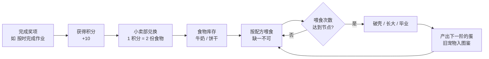
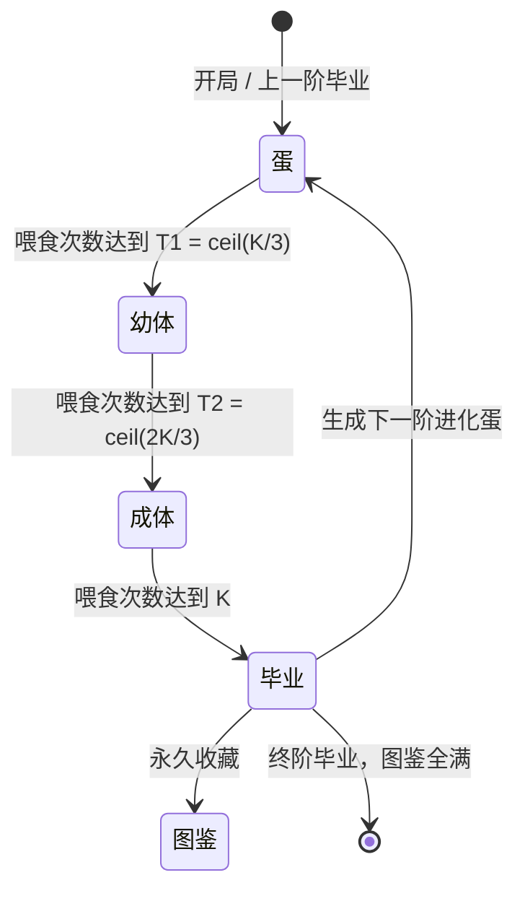

# 孩子宠物养成系统 · 设计说明 v1.0

> **一句话概括**：孩子完成自定义奖项 → 赚积分 → 用积分换牛奶和饼干 → 按配方喂养当前宠物 → 宠物破壳、长大、毕业 → 自动获得更高阶的蛋，依次养下去。
>
> **适用范围**：6–10 岁，单孩或多孩家庭；所有数值家长可配。
> **本文范围**：规则、数值、状态机、数据实体、界面结构、边界处理。**不含代码实现**。
> **设计基调**：只奖励，不惩罚；进度永不倒退。

---

## 0. 速览

### 0.1 核心循环

### 0.2 三条设计原则

| # | 原则 | 具体含义 |
|---|---|---|
| 1 | **只加不减** | 没有扣分、饿死、掉级、过期清零。宠物不会因孩子某天没做好而受苦——激励系统不该变成威胁工具。 |
| 2 | **算得清** | 全部整数、汇率固定、界面直接显示「还差 N 次」。孩子能自己算出「再完成 3 次作业就能破壳」，这本身就是数学练习。 |
| 3 | **有规划感** | 牛奶和饼干是两种缺一不可的食材，兑换时自由组合、喂食时按配方扣减，逼出一步「先想好再换」的决策。 |

### 0.3 关键参数速查

| 参数 | 默认值 | 说明 |
|---|---|---|
| 兑换汇率 | 1 积分 = 2 份食物 | 可换 2 牛奶 / 2 饼干 / 1 牛奶 + 1 饼干 |
| 宠物阶数 | 5 阶 | 依次饲养，**同一时间只照顾 1 只** |
| 每阶形态 | 3 段（蛋 / 幼体 / 成体） | 按喂食次数的 1/3、2/3 切换 |
| 喂食总次数 | 102 次 | 12 → 16 → 20 → 24 → 30，逐阶递增 |
| 全程食物 | 452 份（奶 246 / 饼 206） | 单次配方也逐阶变贵 |
| 全程积分 | 226 积分 | 日均 12–18 分，约 3 周通关 |
| 示例主奖项 | 按时完成作业 = 10 积分 | 每日 1 次，需家长确认 |

---

## 1. 概念与术语

| 术语 | 定义 |
|---|---|
| **奖项** | 家长自定义的一件好事，附带积分值和每日次数上限。 |
| **积分** | 唯一的上游货币，只能由奖项产生，只能流向兑换。 |
| **份** | 食物的最小单位。1 瓶牛奶 = 1 份，1 块饼干 = 1 份。 |
| **配方** | 当前阶宠物「一次喂食」所需的牛奶数与饼干数，缺一不可。 |
| **一次喂食** | 扣掉一份完整配方、`feed_count + 1` 的最小动作。 |
| **形态** | 宠物外观的 3 个阶段：蛋 → 幼体 → 成体，由喂食次数驱动。 |
| **毕业** | 喂食次数达到本阶目标 `K`，当前宠物养成完成。 |
| **进化蛋** | 毕业时自动生成的下一阶新宠物（状态为「蛋」）。 |
| **图鉴** | 永久收藏已毕业宠物，不会因为进化而丢失。 |
| **账本** | 只追加的积分流水，记录每一笔收入、支出与家长调整。 |

---

## 2. 核心循环

### 2.1 一天的 5 步

1. 孩子做完一件事 → 在「今日奖项」点申请（或家长直接发放）。
2. 家长一键确认 → 积分到账，账本记一笔。
3. 孩子进「小卖部」用积分换食物，自由组合牛奶/饼干，食物进库存。
4. 回「我的宠物」点喂食 → 系统校验配方是否凑齐 → 扣库存、播放动画、进度 +1。
5. 进度跨过节点 → 破壳 / 长大 / 毕业；毕业即获得下一阶的蛋，旧宠物入图鉴。

### 2.2 状态机

| 状态 | 孩子看到的 | 能否喂食 | 备注 |
|---|---|---|---|
| 蛋 | 一颗会轻晃的蛋、孵化进度条 | 能 | 喂食 = 「给蛋保暖/加餐」，用动画表达 |
| 幼体 | 小宠物、活泼表情 | 能 | 破壳是高光时刻，建议加音效与彩带 |
| 成体 | 完全体、可互动 | 能 | 显示「还差 N 次毕业」 |
| 毕业 | 毕业证书 + 新蛋揭晓 | 否（自动切到新蛋） | 同一事务完成，不出现空窗期 |
| 图鉴 | 收藏卡、首次毕业日期、用料统计 | — | 只读，永久保留 |

---

## 3. 积分体系

### 3.1 奖项字段定义

| 字段 | 类型 | 说明 | 示例 |
|---|---|---|---|
| `award_id` | ID | 唯一标识 | `A001` |
| `name` | 文本 | 孩子看到的名称 | 按时完成作业 |
| `icon` | 枚举/图片 | 卡片图标 | 📘 |
| `category` | 枚举 | 学习 / 生活 / 品德 / 额外 | 学习 |
| `points` | 正整数 | 每次发放的积分 | 10 |
| `daily_cap` | 正整数 | 每日最多可领次数 | 1 |
| `need_approval` | 布尔 | 是否需家长确认 | 是 |
| `exclusive_group` | 文本（可选） | 同组奖项当天互斥 | `homework` |
| `enabled` / `effective_from` / `effective_to` | — | 启停与生效期 | 长期 / 寒暑假 |
| `source_type` | 枚举 | `manual` / `auto` / `external` | `manual` |
| `note` | 文本 | 家长备注，孩子不可见 | 含订正 |

> `source_type` 是为将来对接英语练习工具预留的（见第 13 节），v1 只用 `manual`。

### 3.2 默认奖项库（可增删改）

| 奖项 | 积分 | 每日上限 | 家长确认 | 类别 |
|---|---:|---:|:---:|---|
| 按时完成作业 | **10** | 1 | 是 | 学习 |
| 作业自查并订正 | 5 | 1 | 是 | 学习 |
| 阅读 20 分钟 | 8 | 2 | 是 | 学习 |
| 英语练习完成 1 组 | 8 | 2 | 否（自动） | 学习 |
| 自己整理书包 | 5 | 1 | 否 | 生活 |
| 按时上床睡觉 | 5 | 1 | 是 | 生活 |
| 练琴 / 运动 20 分钟 | 10 | 1 | 是 | 生活 |
| 主动帮忙做家务 | 5 | 2 | 是 | 品德 |
| 主动承认错误 / 说谢谢 | 3 | 2 | 是 | 品德 |
| 周末特别挑战（家长临时出） | 20 | 1 | 是 | 额外 |

典型一天实际领 2–4 项，约 **12–18 分**；理论上限虽高，但 `daily_cap` 与「确认」两道闸门控制住了刷分。

### 3.3 发放规则

| 编号 | 规则 |
|---|---|
| R1 | 每个奖项当天领取次数 ≤ `daily_cap`，超出后卡片置灰并显示「今天已领过啦」。 |
| R2 | `need_approval = 是` 的奖项，孩子只能**申请**；家长确认前积分不入账，卡片显示「待确认」。 |
| R3 | 同一 `exclusive_group` 内当天只计一项（例如「按时完成」与「补做完成」不叠加）。 |
| R4 | 补记仅限 **T−1 日**，且只能由家长操作，备注必填。 |
| R5 | 不预支、不借贷、余额下限为 0；**任何情况下不扣分为负**。 |
| R6 | 家长可撤回误发的积分，但必须填理由，且账本保留原流水（追加一笔负向调整，不删除历史）。 |

### 3.4 积分账本

每笔流水包含：时间、孩子、类型（`earn` / `spend` / `adjust`）、关联单号（奖项 ID 或兑换单 ID）、积分增减、操作人、备注、**变动后余额快照**。只追加、不修改、不删除；余额可由流水重算校验。

---

## 4. 兑换体系

### 4.1 汇率与自由组合

> **1 积分 = 2 份食物**（对应「1 个积分可以换若干牛奶或饼干」）

一次兑换可任选以下组合之一，也可连续多次兑换：

| 花 1 积分 | 得到 |
|---|---|
| 组合 A | 2 瓶牛奶 |
| 组合 B | 2 块饼干 |
| 组合 C | 1 瓶牛奶 + 1 块饼干 |

| 积分 | 份数 | 最多够几次 Lv1 喂食（每次 2 份） | 最多够几次 Lv5 喂食（每次 6 份） |
|---:|---:|---:|---:|
| 1 | 2 | 1 | 0（需攒） |
| 5 | 10 | 5 | 1 |
| 10 | 20 | 10 | 3 |
| 20 | 40 | 20 | 6 |

**为什么是 1:2 而不是 1:1**：第一阶一次喂食恰好 = 1 奶 + 1 饼 = 2 份 = 1 积分，低阶可以心算；到高阶单次配方涨到 5–6 份，孩子必须开始算「要攒几个积分、牛奶和饼干各差多少」。数值颗粒度刚好卡在「低阶无门槛、高阶需规划」之间。

### 4.2 兑换约束

| 编号 | 规则 |
|---|---|
| R7 | 最小兑换单位 1 积分，不可拆分；兑换后积分立即扣减、库存立即增加，记一笔 `spend` 流水。 |
| R8 | **单向兑换**：食物不可换回积分。避免冲动兑换后反悔与套利，也让「先想好再换」有实际意义。家长可在后台手动纠正并留痕。 |
| R9 | 牛奶、饼干库存各自上限默认 99 份，达上限时禁止继续兑换该品类，防止无脑囤积。 |
| R10 | 小卖部提供「**按当前配方一键补足**」推荐按钮：自动算出还差多少奶/饼、折合几个积分。这是给孩子的脚手架，不代替他自己做决定。 |

> 注意：全程奶 246 份、饼 206 份，两者消耗**不相等**。若孩子一直按「1 奶 + 1 饼」兑换，到 Lv2（2 奶 + 1 饼）就会卡住——这正是 R10 存在的理由。

---

## 5. 宠物与进化链

### 5.1 五阶物种

| 阶 | 宠物 | 蛋 | 外观线索（供美术参考） | 毕业后解锁 |
|---:|---|---|---|---|
| 1 | 云团兽 | 棉花蛋 | 白色圆滚滚、像一朵云 | 暖焰蛋 |
| 2 | 火苗狐 | 暖焰蛋 | 橘红小狐狸、尾巴是火苗 | 星屑蛋 |
| 3 | 星角鹿 | 星屑蛋 | 蓝紫小鹿、角上有星点 | 潮汐蛋 |
| 4 | 海雾鲸 | 潮汐蛋 | 青蓝小鲸、背着水雾 | 星河蛋 |
| 5 | 星辰龙 | 星河蛋 | 金紫色小龙、终阶 | 图鉴全满证书 |

名称、外观、阶数均可在家长后台替换（例如换成恐龙/猫咪主题），不影响规则。

### 5.2 形态节点

设本阶目标喂食次数为 `K`，则：

- `T1 = ceil(K / 3)` → 破壳，蛋变幼体
- `T2 = ceil(2K / 3)` → 长大，幼体变成体
- `K` → 毕业

| 阶 | K | 蛋（0 ~ T1−1） | 幼体（T1 ~ T2−1） | 成体（T2 ~ K−1） | 毕业 |
|---:|---:|---|---|---|---|
| 1 | 12 | 0–3 | 4–7 | 8–11 | 12 |
| 2 | 16 | 0–5 | 6–10 | 11–15 | 16 |
| 3 | 20 | 0–6 | 7–13 | 14–19 | 20 |
| 4 | 24 | 0–7 | 8–15 | 16–23 | 24 |
| 5 | 30 | 0–9 | 10–19 | 20–29 | 30 |

### 5.3 喂食配方与消耗总表（核心数值）

| 阶 | 单次配方（奶 + 饼） | 单次份数 | 折合积分 | 需喂次数 K | 本阶总份数 | 本阶牛奶 | 本阶饼干 | 本阶积分 | 累计积分 |
|---:|---|---:|---:|---:|---:|---:|---:|---:|---:|
| 1 | 1 + 1 | 2 | 1 | 12 | 24 | 12 | 12 | **12** | 12 |
| 2 | 2 + 1 | 3 | 1.5 | 16 | 48 | 32 | 16 | **24** | 36 |
| 3 | 2 + 2 | 4 | 2 | 20 | 80 | 40 | 40 | **40** | 76 |
| 4 | 3 + 2 | 5 | 2.5 | 24 | 120 | 72 | 48 | **60** | 136 |
| 5 | 3 + 3 | 6 | 3 | 30 | 180 | 90 | 90 | **90** | 226 |
| **合计** | — | — | — | **102** | **452** | **246** | **206** | **226** | — |

> 「折合积分」出现 1.5 / 2.5 只是**统计口径**：实际交易永远是「整积分 → 整数份 → 扣库存」，不存在小数积分。孩子看到的是库存里还有几瓶奶、几块饼。
>
> **「食物需要更多」体现在两处**：单次配方从 2 份涨到 6 份，同时总喂食次数从 12 次涨到 30 次。最后一阶的消耗是第一阶的 **7.5 倍**。

### 5.4 喂食判定

| 编号 | 规则 |
|---|---|
| R11 | 一次喂食必须**同时凑齐**当阶配方的牛奶数与饼干数；缺任一种，按钮置灰并明确提示「还差 1 块饼干」，不允许只喂一种。 |
| R12 | 喂食成功后原子扣减库存、`feed_count + 1`、写一条喂食记录；连续点击需做防重（同一次点击只生效一次）。 |
| R13 | 每次喂食后的形态变化、毕业判定在同一事务内完成，避免中途刷新导致状态不一致。 |

### 5.5 毕业与进化

`feed_count == K` 时，在一个事务内依次发生：

1. 当前宠物 `status → graduated`，生成毕业证书（编号、日期、总喂食次数、累计用料）。
2. 图鉴落库一条永久记录。
3. 创建下一阶 `PetInstance`（`status = egg`，`feed_count = 0`），设为「当前宠物」。
4. 主界面揭晓新蛋，播放进化动画。

**关键点**：进化不「吃掉」旧宠物，只是把「当前照顾对象」换成新蛋；旧宠物随时可在图鉴回看，避免孩子产生「我的宠物没了」的失落。

### 5.6 终阶处理

第 5 阶毕业后图鉴全满，发放「全满证书」+ 一枚**纪念蛋**（可陈列、不消耗食物）。家长可选择：
- 结束赛季，留作阶段成就；
- 或开启**二周目**（见第 14 节），配方与次数按 1.5 倍，宠物换「星光」外观。

---

## 6. 规则清单（实现时可直接引用）

| 编号 | 一句话规则 |
|---|---|
| R1 | 奖项受 `daily_cap` 限制 |
| R2 | 需确认的奖项，家长通过后才入账 |
| R3 | 同互斥组当天只计一项 |
| R4 | 补记仅限 T−1 日、仅限家长、备注必填 |
| R5 | 余额不为负，不预支、不扣分 |
| R6 | 撤回误发只追加调整流水，不删历史 |
| R7 | 兑换最小 1 积分，1 积分 = 2 份，扣积分加库存 |
| R8 | 兑换单向不可逆 |
| R9 | 单品类库存上限 99 份 |
| R10 | 提供「按配方一键补足」推荐 |
| R11 | 喂食必须凑齐完整配方 |
| R12 | 喂食原子扣减、防重复提交 |
| R13 | 形态与毕业判定同事务完成 |
| R14 | 同一孩子同时只有 1 只「进行中」宠物 |
| R15 | 配置变更只影响未来，不追溯已发生的流水与已毕业记录 |

---

## 7. 数据模型（逻辑实体，不含建表语句）

| 实体 | 主要字段 | 说明 |
|---|---|---|
| `Child` | `id, name, avatar, points_balance, current_pet_id` | 多孩各自独立账本与宠物链 |
| `Award` | 见 3.1 | 家长自定义奖项库 |
| `AwardClaim` | `id, child_id, award_id, date, status[pending/approved/rejected], approver, created_at` | 申请与确认记录，用于 `daily_cap` 判定 |
| `PointLedger` | `id, child_id, type, delta, ref_type, ref_id, operator, note, balance_after, created_at` | 只追加流水 |
| `ExchangeOrder` | `id, child_id, points_spent, milk_qty, cookie_qty, created_at` | 一次兑换单 |
| `FoodStock` | `child_id, milk, cookie, updated_at` | 冗余当前库存；可由兑换单与喂食记录重算校验 |
| `PetSpecies` | `id, tier, name, egg_name, formula_milk, formula_cookie, feed_times K, next_species_id` | 物种链配置，家长可编辑 |
| `PetInstance` | `id, child_id, species_id, status, feed_count, started_at, graduated_at` | 一只宠物的完整生命周期 |
| `FeedingRecord` | `id, pet_id, milk_used, cookie_used, feed_count_after, created_at` | 每次喂食留痕 |
| `Codex` | `child_id, species_id, first_graduated_at, total_feedings, milk_used, cookie_used, certificate_no` | 图鉴，永久只读 |

**关系**：`Child 1—N PetInstance`（其中最多 1 只进行中）；`PetSpecies` 通过 `next_species_id` 串成单向链；`AwardClaim → PointLedger(earn)`、`ExchangeOrder → PointLedger(spend)` 一一对应，保证账实相符。

---

## 8. 页面与交互

### 8.1 孩子端（3 页，建议大按钮、少文字、无滚动条）

| 页面 | 主要内容 | 关键反馈 |
|---|---|---|
| **我的宠物**（首页） | 宠物主视觉、形态、进度条、「还差 N 次破壳/毕业」、当前配方、库存余量、大号「喂一次」按钮、图鉴入口 | 破壳彩带、长大变形、毕业证书翻页 |
| **今日奖项** | 卡片列表（三态：可申请 / 待确认 / 已到账）、今日已得积分、连续天数 | 积分数字滚动增加、卡片盖章 |
| **小卖部** | 积分余额、兑换数量选择、牛奶/饼干分配、当前库存、「按配方一键补足」推荐 | 食物飞入库存动画 |

### 8.2 家长端（3 页）

| 页面 | 主要内容 |
|---|---|
| **待确认** | 一键通过 / 驳回（驳回需填一句鼓励性说明）、批量通过、补记入口 |
| **奖项管理** | 增删改、积分值、每日上限、需确认开关、启停、排序、假期模式 |
| **设置与统计** | 汇率、宠物链与配方、库存上限、多孩切换；本周积分趋势、各奖项分布、连续天数、宠物进度 |

### 8.3 文案与反馈原则

- 只说「还差 3 次」「再换 1 块饼干就够啦」，**不说**「失败」「不足」「惩罚」「饿」。
- 三个高光时刻（破壳 / 长大 / 毕业）必须有明显动画与音效，这是整个系统的情绪支点。
- 进度永远可视化：进度条 + 数字双显示，不用纯百分比。

---

## 9. 家长配置台

| 可配项 | 默认值 | 影响 |
|---|---|---|
| 汇率（积分→份） | 1 : 2 | 直接决定整条链的时长 |
| 奖项库 | 第 3.2 节 | 决定日均积分 |
| 每阶配方与 K | 第 5.3 节 | 决定难度曲线 |
| 阶数与物种名称 | 5 阶 | 决定总周期 |
| 形态阈值 | K 的 1/3、2/3 | 决定多久看到一次变化（建议别超过 1/3，前期反馈要密） |
| 库存上限 | 99 份/品类 | 防囤积 |
| 假期模式 | 关闭 | 开启后暂停发放但不冻结宠物、不清零进度 |
| 日均目标提示 | 15 分 | 仅供家长参考，不展示给孩子 |

**约束**：任何配置修改只对**未来**生效（R15）。已毕业的图鉴记录写死当时的配方与用料，不随配置回溯变化，否则历史会失真。

---

## 10. 边界与异常

| 场景 | 系统行为 |
|---|---|
| 积分不足 | 兑换按钮置灰，提示「还差 N 个积分」，引导回今日奖项 |
| 食材不齐 | 喂食按钮置灰，精确提示缺哪种、差几个（R11） |
| 连续快速点喂食 | 防重提交，一次点击只扣一次库存（R12） |
| 家长驳回申请 | 卡片回到「可申请」或标记今日已完成，不计积分、不扣积分 |
| 家长撤回误发 | 追加一笔 `adjust` 负向流水并填理由；若积分已花完，允许余额为 0 不追债 |
| 断更一周 / 生病 / 出游 | 宠物原地等待，进度不倒退、形态不回退、图鉴不回收 |
| 假期模式 | 奖项暂停发放，宠物状态冻结保留；恢复后接着喂 |
| 多孩 | 积分账本、库存、宠物链完全隔离；家长端可切换查看 |
| 中途改配置 | 只影响新产生的喂食与兑换；已毕业记录锁定 |
| 兑换单与库存对不上 | 以流水重算为准，家长端提供「校验并修复」入口 |
| 终阶毕业 | 发全满证书 + 纪念蛋，等待家长决定是否开二周目 |

---

## 11. 节奏预估与调参

按日均 **12–18 分**估算：

| 里程碑 | 累计积分 | 预计时点 |
|---|---:|---|
| 第 1 只毕业，拿到暖焰蛋 | 12 | 第 1–2 天 |
| 破壳出第 2 只 | ~24 | 第 3 天 |
| 第 3 阶毕业 | 76 | 第 6–8 天 |
| 第 4 阶毕业 | 136 | 第 11–14 天 |
| 图鉴全满 | 226 | **约 3 周**（含周末） |

**第一周示例**：

| 天 | 完成的事 | 当日积分 | 累计 | 宠物进展 |
|---|---|---:|---:|---|
| D1 | 作业 10 + 整理书包 5 | 15 | 15 | 云团兽毕业，暖焰蛋到手 |
| D2 | 作业 10 + 阅读 8 | 18 | 33 | 火苗狐破壳 |
| D3 | 作业 10 + 练琴 10 | 20 | 53 | 火苗狐长大 |
| D5 | 作业 10 + 英语练习 8 | 18 | 71 | 火苗狐毕业，星屑蛋 |
| D7 | 周末挑战 20 + 阅读 8 | 28 | 99 | 星角鹿破壳 |

**想调快慢**（改一个参数即可，不建议同时改多个）：

| 目标 | 调整 | 全程积分 |
|---|---|---:|
| 更快（约 2 周） | 汇率改 1 积分 = 3 份 | ≈ 151 |
| 更慢（约 5–6 周） | 汇率改 1 积分 = 1 份 | ≈ 452 |
| 只拉长后期 | 保持汇率，把 4/5 阶 K 各 ×1.5 | ≈ 300 |
| 只降低门槛 | 保持汇率，把第 1 阶 K 改成 8 | ≈ 224 |

---

## 12. 设计取舍：被否决的方案

| 方案 | 为什么不采用 | 替代做法 |
|---|---|---|
| 宠物会饿 / 掉级 / 死亡 | 等于把「没做好」变成惩罚，中断一次后孩子容易直接放弃 | 只加不减，图鉴永久保留 |
| 心情值随时间衰减 | 制造焦虑，且家长得盯着维护，违背习惯养成的初衷 | 默认关闭；心情只做表情彩蛋，不影响任何进度 |
| 积分直接喂食，跳过兑换 | 少了「换算 + 规划」这一步，教育价值流失 | 保留 积分 → 食物 → 喂食 三段式 |
| 牛奶饼干随意混喂 | 两种食材失去区分度，后面的配方递增也没意义 | 按阶固定配方，缺一不可 |
| 多只宠物并行饲养 | 分散注意力、稀释每只的成就感 | 单只依次饲养，聚焦一条链 |
| 抽奖 / 随机孵化 | 随机奖励削弱「努力 = 回报」的因果感 | 全确定性，次数到就变化 |
| 1 积分 = 1 份食物 | 高阶数字偏大，低阶又没有换算感 | 1 : 2，低阶可心算、高阶需规划 |
| 食物可换回积分 | 会出现反悔与套利，「先想好再换」形同虚设 | 单向兑换；家长可手动纠正并留痕 |
| 用扣分约束没完成的事 | 与「只奖励」基调冲突，容易引发对抗 | 只记录「没领」，不记录「做错」 |

---

## 13. 与现有英语学习工具的衔接（可选，v1 可不做）

- 已有的单词练习 / NCE1 练习 / 句型复述，完成时可作为 `source_type = auto` 的奖项自动发分（`need_approval = false`），例如「英语练习完成 1 组 = 8 分」。
- 建议**共用一套积分账户**，宠物系统只做积分的下游消费方，避免两套积分让孩子困惑；若必须隔离，用单向「积分券」转入。
- 宠物形象可嵌入练习页面作为陪伴角色（答对时有反应），但**不参与答题判定**，避免把学习反馈和养成反馈混在一起。
- 接口只需预留三个字段：`source_type`、`external_ref_id`、`external_source`。

---

## 14. v2 设想

- **成就徽章**：连续 7 天、单日满额、图鉴全满、单阶零浪费兑换。
- **宠物装扮**：用积分买帽子/背景，纯外观，不影响成长数值。
- **二周目**：图鉴全满后开启「星光形态」，配方与次数 ×1.5，外观换色。
- **家长周报**：每周一封小结（积分趋势、最常完成的奖项、宠物进度），不做孩子间的横向比较。
- **语音鼓励**：破壳/毕业时播一句短语音，低龄孩子更吃这一套。

---

## 附录 A · 默认参数总表

| 键 | 默认值 |
|---|---|
| `exchange_rate`（积分→份） | 2 |
| `stock_cap_per_food` | 99 |
| `tiers` | 5 |
| `form_thresholds` | `ceil(K/3)`, `ceil(2K/3)` |
| `species[1]` | 云团兽 / 棉花蛋 / 1 奶 + 1 饼 / K=12 |
| `species[2]` | 火苗狐 / 暖焰蛋 / 2 奶 + 1 饼 / K=16 |
| `species[3]` | 星角鹿 / 星屑蛋 / 2 奶 + 2 饼 / K=20 |
| `species[4]` | 海雾鲸 / 潮汐蛋 / 3 奶 + 2 饼 / K=24 |
| `species[5]` | 星辰龙 / 星河蛋 / 3 奶 + 3 饼 / K=30 |
| `awards.default` | 见 3.2 |
| `holiday_mode` | off |
| `daily_target_hint` | 15 |
| **全程合计** | 102 次喂食 / 452 份食物 / 226 积分 |

## 附录 B · 后续实现时的验收清单

- [ ] 完成一个奖项 → 余额增加，账本有一条 `earn` 流水
- [ ] 未确认的申请不产生积分；同一奖项当天超额不可再领
- [ ] 1 积分能换 2 牛奶 / 2 饼干 / 1+1，三种组合都正确入库存
- [ ] 库存缺 1 块饼干时喂食按钮置灰且提示精确
- [ ] 一次点击只扣一次库存（防重）
- [ ] 喂到 `T1` 破壳、`T2` 长大、`K` 毕业，形态与次数完全对齐第 5.2 节表格
- [ ] 毕业的同一次操作里生成下一阶蛋，主界面无空窗
- [ ] 旧宠物在图鉴中可查，证书数据不被后续配置改动覆盖
- [ ] 断更 7 天后回来，进度、形态、图鉴均不变
- [ ] 家长撤回流水只追加不删除；余额可由流水重算且一致
- [ ] 配置修改后，已毕业记录保持原值
- [ ] 第 5 阶毕业后发全满证书，不出现第 6 阶

---

*文档版本：v1.0 · 2026-11-21 · 待家长确认默认数值后进入实现阶段*
